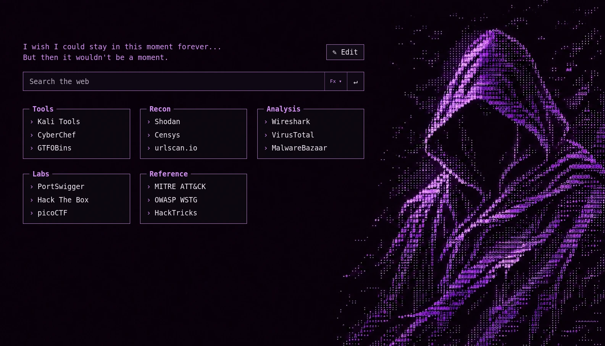

# Violet Start

Violet Start — настраиваемая новая вкладка для настольного Firefox в фиолетовой палитре с ASCII-артом. На одной странице собраны обычный веб-поиск и быстрые ссылки на инструменты, лаборатории и справочники по информационной безопасности.



## Установка в Firefox

Для установки готового пакета нужен настольный Firefox 142 или новее. Чтобы собрать ZIP из исходников, понадобятся Node.js 24 и pnpm 11.

```sh
git clone --branch dev https://github.com/brokendevis/violet-start.git
cd violet-start
pnpm install --frozen-lockfile
pnpm package
```

1. Откройте в Firefox `about:debugging#/runtime/this-firefox`.
2. Нажмите **Загрузить временное дополнение** (**Load Temporary Add-on**).
3. Выберите `artifacts/violet-start-0.1.0.zip`.
4. Откройте новую вкладку через `Ctrl+T`.

Firefox выгружает временное дополнение при перезапуске. Для повторной установки выберите тот же ZIP. **Export saved settings** позволяет сохранить копию настроек перед переустановкой или переносом в другой профиль.

## Использование

### Поиск и быстрые ссылки

Откройте компактный переключатель справа в поле поиска и выберите **Firefox default**, **Google**, **Yandex** или **DuckDuckGo**. Первый вариант использует поисковик, выбранный в настройках Firefox. Violet Start запоминает ваш выбор для следующих вкладок. Введите запрос и нажмите `Enter` или стрелку справа. Результаты открываются в текущей вкладке.

При первом запуске доступны пять подборок.

| Группа | Ссылки |
| --- | --- |
| **Tools** | Kali Tools, CyberChef, GTFOBins |
| **Recon** | Shodan, Censys, urlscan.io |
| **Analysis** | Wireshark, VirusTotal, MalwareBazaar |
| **Labs** | PortSwigger, Hack The Box, picoCTF |
| **Reference** | MITRE ATT&CK, OWASP WSTG, HackTricks |

### Цитата, группы и обои

Нажмите **Edit**, чтобы открыть боковую панель.

- В поле **Quote** можно изменить цитату. Оставьте поле пустым, чтобы скрыть её.
- В **Groups** можно добавлять, переименовывать, удалять и переставлять группы. У каждой ссылки есть название и полный адрес с `https://` или `http://`. Кнопки со стрелками меняют порядок.
- В **Wallpaper** можно выбрать **Shadow**, **Raven** или **Eclipse**. Через **Upload wallpaper** можно загрузить свой PNG, JPEG или WebP размером до 2 МиБ и разрешением до 24 мегапикселей. Тот же лимит действует для обоев внутри резервной копии.

Нажмите **Save**, чтобы применить изменения. Они появятся и в других открытых вкладках Violet Start. **Cancel** или `Esc` закрывает редактор и отменяет черновик.

### Резервная копия

В разделе **Backup** кнопка **Export saved settings** скачивает JSON с сохранёнными группами, ссылками, цитатой, обоями и поисковиком. Если вы загрузили своё изображение, оно включается в файл. Сначала нажмите **Save**, чтобы изменения из редактора попали в экспорт.

Для восстановления выберите JSON через **Import backup** и подтвердите замену текущих настроек. Допустимый размер файла — до 5 МиБ. Violet Start проверяет файл перед заменой.
Если вкладка сообщает, что сохранённые настройки не удалось прочитать, восстановите исправную копию через **Edit → Import backup**.

## Локальные данные и разрешения

Настройки хранятся в локальном хранилище расширения Firefox. Встроенные обои поставляются вместе с расширением. Саму вкладку и редактор можно открыть без интернета. При отправке поиска запрос получает выбранный поисковик.

В манифесте два разрешения. `storage` используется для настроек, а `search` — для отправки запроса через поисковик Firefox по умолчанию.

## Разработка

Проект использует Vue 3, TypeScript, Vite, Pinia и Zod. Расширение собрано на Firefox WebExtensions Manifest V3.

| Команда | Что делает |
| --- | --- |
| `pnpm dev` | Пересобирает расширение в `dist/` при изменении файлов |
| `pnpm typecheck` | Проверяет типы TypeScript и компоненты Vue |
| `pnpm test` | Проверяет манифест, адреса поисковиков и обработку настроек |
| `pnpm build` | Собирает расширение в `dist/` |
| `pnpm format` | Форматирует исходники и тесты через Prettier |
| `pnpm format:check` | Проверяет форматирование исходников и тестов |
| `pnpm check` | Проверяет форматирование и типы, запускает тесты и сборку, проверяет пакет через `web-ext lint` |
| `pnpm package` | Собирает и упаковывает ZIP в `artifacts/` |

Для разработки запустите `pnpm dev` и загрузите `dist/manifest.json` как временное дополнение. После пересборки нажмите **Reload** на странице отладки Firefox и откройте новую вкладку.

Основная страница и редактор находятся в [src/](src/), манифест и встроенные обои — в [public/](public/), тесты — в [tests/](tests/).

- [settingsStore.ts](src/settingsStore.ts) хранит состояние открытой вкладки в Pinia и обновляет его при изменениях настроек. Черновик остаётся в редакторе.
- [settings.ts](src/settings.ts) проверяет данные схемой Zod и читает или записывает их в Firefox. Записи из нескольких вкладок проходят под одной блокировкой. Формат бэкапа версии 1 сохраняется.
- [wallpaper.ts](src/wallpaper.ts) описывает встроенные обои и проверяет загруженные изображения.

### Проверка готового ZIP

Запустите `pnpm check` и `pnpm package`, затем установите ZIP в отдельном профиле Firefox. Пройдите основные сценарии.

1. Откройте новую вкладку и проверьте поиск через все четыре сервиса. Выбор должен сохраниться в следующей вкладке. Перейдите к переключателю клавишей `Tab` и проверьте, что фокус остаётся видимым после смены поисковика.
2. Проверьте область просмотра на ширинах 320, 390, 768 и 1440 CSS-пикселей и при масштабе 200%. Поле ввода остаётся доступным, длинное название группы переносится, а кнопки редактора помещаются в окно.
3. В двух вкладках проверьте сохранение и отмену правок. Замените фон, экспортируйте настройки и восстановите их из JSON. Некорректный файл должен оставить текущие настройки на месте.
4. Отключите сеть и откройте новую вкладку. Интерфейс, локальные обои и редактор должны открываться.
